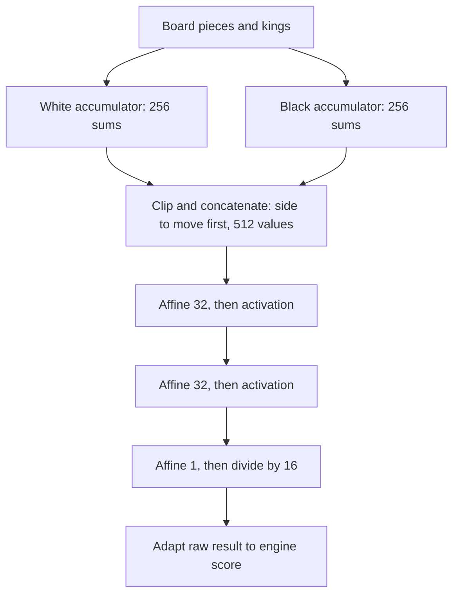
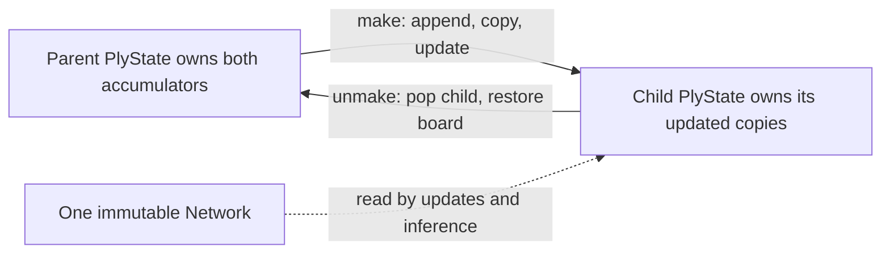

# Understanding Latrunculi’s HalfKP NNUE

This chapter follows a position from its pieces to the number used by search.
It assumes familiarity with C++ arrays and functions, but no neural-network
background. Start with the scalar code; the SIMD implementation performs the
same arithmetic on several numbers at once.

The implementation described here uses the pretrained Stockfish 12 network
`nn-82215d0fd0df.nnue`. Latrunculi implements the inference kernels, board-state
integration, and engine-score adapter. The learned weights come from Stockfish.
The [network provenance record](../networks/README.md) identifies the exact
network, reference revision, checksum, and license.

For build commands and oracle setup, use the existing
[HalfKP NNUE reference](nnue-halfkp.md). This chapter explains the machinery
behind those commands.

- [What the evaluator does](#what-the-evaluator-does)
- [From weighted sums to a network](#from-weighted-sums-to-a-network)
- [Encoding a board with HalfKP](#encoding-a-board-with-halfkp)
- [Accumulators and reversible moves](#accumulators-and-reversible-moves)
- [The exact forward pass](#the-exact-forward-pass)
- [Quantization and arithmetic safety](#quantization-and-arithmetic-safety)
- [How AVX2 performs the same calculation](#how-avx2-performs-the-same-calculation)
- [From embedded bytes to search](#from-embedded-bytes-to-search)
- [What the verification establishes](#what-the-verification-establishes)
- [Reading, tracing, and future training](#reading-tracing-and-future-training)

## What the evaluator does

Search explores possible continuations and chooses a move. Evaluation estimates
how favorable one position is. A static evaluation does not explore future
moves by itself, and its result is neither a move nor a guaranteed game outcome.
Search can disagree with it after discovering a tactical continuation.

The engine-facing entry point is `eval::evaluate` in
[evaluation.cpp](../src/eval/evaluation.cpp). It passes the board's cached neural
state and side to move to `nnue::evaluate`. A positive static score favors the
side to move; a negative score favors its opponent. Search uses that convention
when comparing continuations from alternating sides.

**Training** adjusts weights using many examples. **Inference** applies fixed
weights to a new input. Latrunculi performs inference during play. Making moves,
searching, and updating search histories do not train this network. SPSA search
tuning changes a separate set of search parameters.

NNUE means an efficiently updatable neural network. The important observation
is that adjacent positions share almost all their pieces. Much of evaluation
can be retained and updated when a piece moves, instead of recomputed from zero.
This implementation does that for the large first layer. The small layers after
it are evaluated again whenever an evaluation is requested.

NNUE is Latrunculi's sole positional evaluator. Two other uses of piece values
remain in search:

- [material_values.hpp](../src/board/material_values.hpp) provides
  `pruning_value` for material thresholds and singular-search margins, and
  `qsearch_capture_value` for quiescence capture-delta pruning.
- [see_values.hpp](../src/board/see_values.hpp) provides exchange prices for
  static exchange evaluation (SEE) and capture ordering. SEE estimates the
  material consequences of an exchange on a square.

These tables are search tools. They are not another positional evaluator blended
with the network.

## From weighted sums to a network

A **feature** is an input fact encoded as a number. A **weight** says how strongly
that input contributes to a calculation. A **bias** is a starting value, present
even when every input is zero. One output of a layer is a weighted sum followed
by an **activation**, a function that transforms the sum.

Consider this synthetic example, unrelated to the actual pretrained weights:

```text
sum = 2 + 3*x0 - 1*x1
output = clamp(sum, 0, 127)
```

Here `2` is the bias and `3` and `-1` are weights. If both binary features are
active, `x0 = x1 = 1`, the sum and output are `4`. If only `x0` is active, they
are `5`. The activation maps a negative sum to zero and a sum above 127 to 127.
The real network's integer scaling is described later.

This clipping operation is called a **clipped rectified linear unit**, or
clipped ReLU. Rectifying removes negative values; clipping adds the upper
ceiling. These names describe an arithmetic function, not a particular chess
concept.

A **neuron** is one such output calculation. A **layer** calculates several
outputs from the same inputs. An affine layer means the weighted sum plus bias;
the activation is a separate operation. For output `i`:

```text
sum[i] = bias[i] + sum over j of (weight[i,j] * input[j])
```

Stacking layers lets later neurons combine earlier outputs. Clipping makes the
network nonlinear: the effect of an input can depend on which other inputs
have already pushed a neuron to zero or its ceiling. Without nonlinear
activations, a stack of affine layers could be collapsed into one affine layer.
The learned neurons have no prescribed meanings such as "king safety" or
"bishop pair"; those are possible interpretations to investigate, not labels
assigned by this code.

### The architecture and its two perspectives

The fixed dimensions are in [nnue.hpp](../src/eval/nnue.hpp), and the parameter
arrays are in [nnue_network.hpp](../src/eval/nnue_network.hpp). The architecture
is conventionally written:

```text
41,024 features per perspective
    -> 256 accumulator entries per perspective
    -> concatenate the two clipped perspectives into 512 inputs
    -> 32 -> 32 -> 1
```

The first operation is the **feature transformer**. Both perspectives use the
same learned transformer weights and biases, applied to differently encoded
inputs. There are two accumulator states, not two independently trained
transformers. White's perspective is conditioned on White's king, and Black's
on Black's king. Each describes non-king pieces from its own viewpoint.



The transformer contains `41,024 * 256 = 10,502,144` weights. Including its
biases and the three later layers, the network stores 10,519,905 weight and
bias values, including reserved feature rows. Almost all are in the transformer.
Its sparse inputs are what make this practical to evaluate on a CPU.

## Encoding a board with HalfKP

HalfKP associates each non-king piece with the king of the perspective being
evaluated. `K` refers to the king and `P` to a piece; `P` covers all non-king
piece types, not just pawns. Each perspective supplies one king-conditioned
half of the eventual input. An active feature describes four facts:

```text
(perspective's king square, piece square, piece type, friendly or opposing)
```

"Relative to the king" here means the feature index depends on that king and
the viewing perspective. The code does not subtract the king's coordinates
from the piece's coordinates.

Each possible feature is conceptually a binary input: `1` if present and `0`
otherwise. **Sparse** means that very few inputs are nonzero. A position with
32 pieces has only 30 non-king pieces, so at most 30 features are active per
perspective. The implementation enumerates those pieces and accesses their
weight rows; it does not construct an array of 41,024 zeros and ones.

Kings are excluded from the list of pieces being added. The perspective's king
still selects the feature group for every other piece. The opposing king is
not an explicit piece feature in this legacy architecture. Both king positions
still affect the final output because both perspectives are used.

### Squares, colors, and the exact index

[square.hpp](../src/core/square.hpp) numbers squares from `A1 = 0` to `H8 = 63`,
with consecutive files within each rank. For example, `E1 = 4`, `E2 = 12`,
`E4 = 28`, and `E8 = 60`.
[types.hpp](../src/core/types.hpp) defines `BLACK = 0` and `WHITE = 1`.
[piece.hpp](../src/core/piece.hpp) defines `PAWN = 1` through `QUEEN = 5`, with
`KING = 6`. The feature mapping uses `PieceType`, not the encoded colored `Piece`
value.

`nnue::feature` in [nnue.hpp](../src/eval/nnue.hpp) first orients both squares:

```text
rotation = 63 for Black's perspective, otherwise 0
oriented_piece = piece_square XOR rotation
oriented_king  = king_square XOR rotation
```

XOR with 63 rotates this square numbering by 180 degrees: `A1` becomes `H8`,
and `E8` becomes `D1`. This is a rotation of both files and ranks, not just a
rank flip. The explicit comparison with `BLACK` matters because the two engines'
color encodings must not be assumed interchangeable.

The final formula is:

```text
index = 641 * oriented_king
      + 1
      + 128 * (piece_type - 1)
      + (64 if piece_color != perspective, otherwise 0)
      + oriented_piece
```

For each king square, five piece types each have 64 friendly and 64 opposing
piece-square slots: `5 * 2 * 64 = 640`. A reserved slot precedes them, making
the stride 641. There are 64 king groups, hence `64 * 641 = 41,024` inputs.
The reserved indices `641*k` are never activated by this mapping. They are 64
legacy format slots, not features to invent or remove when decoding weights.

The `+1` skips the reserved slot, `128` skips a pair of friendly/opposing
piece-square blocks, and `+64` selects the opposing block. A Black piece is
friendly when encoding Black's perspective. Friendly/opposing is a relationship,
not a direct reuse of either color's numeric value.

### Worked move: e2e4

Take the standard starting position. White's king is on `E1`, Black's on `E8`.
The White pawn moves from `E2` to `E4`, without a capture or king move.

For White's perspective, there is no rotation and the pawn is friendly:

```text
old = 641*4 + 1 + 128*0 + 0 + 12 = 2577
new = 641*4 + 1 + 128*0 + 0 + 28 = 2593
```

For Black's perspective, the pawn is opposing. Rotate Black's king to
`60 XOR 63 = 3`, and the pawn squares to `12 XOR 63 = 51` and
`28 XOR 63 = 35`:

```text
old = 641*3 + 1 + 128*0 + 64 + 51 = 2039
new = 641*3 + 1 + 128*0 + 64 + 35 = 2023
```

These are indices into the shared transformer. White removes row 2577 and adds
row 2593; Black removes row 2039 and adds row 2023. Each row contains 256
weights. The row numbers identify inputs, not evaluation scores.

## Accumulators and reversible moves

An **accumulator** stores the transformer's sums before clipping. For a
perspective `p` and accumulator entry `j`:

```text
A[p,j] = transformer_bias[j]
       + sum over active features f for p of transformer_weight[f,j]
```

`nnue::refresh` in [nnue.cpp](../src/eval/nnue.cpp) implements exactly this:
copy the 256 biases, enumerate non-king pieces, calculate each feature index,
and add its row. Weights for feature `f` begin at `weights.data() + f * hidden`.
The biases are included once per perspective, not once per piece.

### Updating a sum instead of rebuilding it

If the king used by a perspective has not moved, an ordinary move changes only
two features. The new sum is:

```text
A_new[p] = A_old[p] - W[removed_feature] + W[added_feature]
```

This is a vector equation: perform it for all 256 entries. The other pieces'
rows and the original bias are already present. `nnue::update` selects the row
and calls the scalar or AVX2 addition kernel with sign `-1` or `+1`.

For `e2e4`, the exact updates are:

```text
A_new[WHITE] = A_old[WHITE] - W[2577] + W[2593]
A_new[BLACK] = A_old[BLACK] - W[2039] + W[2023]
```

Keep the unclipped sums. Clipping loses information: if a stored activation is
127, the underlying sum could have been 127 or 500. Subtracting a feature from
that activation cannot recover the correct new sum. The accumulator retains
the signed value, and clipping happens when preparing an evaluation.

### Where state lives

[PlyState](../src/board/ply_state.hpp) contains both accumulators as owned arrays.
Together they occupy `2 * 256 * 2 = 1,024` bytes. The `Accumulators` type is
aligned to 64 bytes. `Board` owns a vector of these reversible history entries.

`Board::push_ply_state` in [board.hpp](../src/board/board.hpp) appends a child
state and copies the parent's accumulators before move-specific updates.
`Board::unmake` in [board_move.cpp](../src/board/board_move.cpp) pops the child
and restores piece placement. The parent's exact accumulator arrays become
current again; unmake does not apply inverse neural deltas.
This couples neural restoration to the history stack instead of requiring a
separate inverse update for each special move. The cost is copying the 1,024
accumulator bytes when creating a child state.



Appending to a vector can relocate its elements. The code saves the parent's
index, appends the child, and then reacquires the parent by index. It does not
keep a reference to the parent across a possible reallocation. No accumulator
stores pointers into this vector.

Board copying and assignment in
[board_representation.cpp](../src/board/board_representation.cpp) copy the history
and piece representation. Workers therefore own independent position states,
while all read the same immutable network weights. Changing one worker's board
does not modify another worker's accumulators.

### Every kind of transition

`Board::make` first completes captures, piece placement, promotions, castling
rook placement, and king-square updates. It then updates neural state for both
perspectives. This order is essential for a refresh to see the completed board.

| Transition | Neural-state operation |
| --- | --- |
| Ordinary non-king move | Remove the source feature and add the destination feature in both perspectives. |
| Capture | Also remove the captured piece's feature in both perspectives. |
| King move | Refresh the moving king's perspective. The other perspective applies any captured-piece delta; the king itself has no piece feature. |
| Castling | Refresh the moving king's perspective after both king and rook have moved. Update the rook's source/destination features in the other perspective. |
| En passant | Remove the captured pawn at its actual square, which differs from the mover's destination; update the moving pawn normally. |
| Promotion | Remove the pawn feature at the source and add the promoted piece's feature at the destination; also remove a captured piece when present. |
| Null move | Copy both accumulators unchanged and switch the side to move. No piece feature changes. |
| Unmake or unmake-null | Pop the child history entry and restore the corresponding board/turn state. |
| FEN loading | Place all pieces, establish king squares and turn, then fully refresh both perspectives. |

A king move changes the king group for every active feature of that perspective.
Refreshing is simpler than subtracting and re-adding all those rows. The other
perspective's own king has stayed in place, so its feature group remains valid.

`Board::load_fen` in [board_fen.cpp](../src/board/board_fen.cpp) parses the FEN
before clearing the position. A FEN rejected by parsing leaves the previous
board and its neural state intact. Successful loading replaces the history
with a refreshed root state. See the piece-count limits in
[fen_parser.cpp](../src/board/fen_parser.cpp), which support the accumulator
bound discussed below.

After a real move, `Board::make` switches the turn after neural updates. For
NNUE, a null move changes only the evaluation input ordering; the cached sums
do not need refreshing. That ordering is the next part of the calculation.

## The exact forward pass

The **forward pass** is the sequence of calculations that produces an output
from an input. `nnue::trace` in [nnue.cpp](../src/eval/nnue.cpp) performs the
whole sequence and returns its intermediate values in a `Trace`. This is also
the production inference path: `raw` takes the raw result from that trace,
and `evaluate` adapts it into an engine score.

### 1. Clip and order the perspectives

The network sees the side-to-move accumulator first and the opponent's second.
For a turn `t`, define a 512-element input `x`:

```text
x[j]       = clamp(A[t,j],  0, 127)       for j = 0..255
x[256 + j] = clamp(A[~t,j], 0, 127)       for j = 0..255
```

`~t` is the engine's color-flipping operator. The accumulator arrays themselves
remain indexed by absolute color. Ordering happens when `trace` writes the
transformed input; a null move does not swap or rewrite the saved arrays.

`transform_scalar` clips and converts signed 16-bit sums to unsigned bytes.
**There is no division by 64 at this stage.** An accumulator entry of 64
becomes an input byte of 64; an entry of -3 becomes 0; an entry of 200 becomes
127.

### 2. Apply the two hidden affine layers and activations

`dense_scalar` implements the affine equation introduced earlier. The later
layers are **dense** because each output uses every input, rather than looking
up a short list of active features.

Use `D(W,b,x)` to mean an affine layer and define the hidden activation `H`:

```text
D(W,b,x)[i] = b[i] + sum over j of W[i,j] * x[j]
H(v)       = min(127, max(0, v) / 64)    using integer division

s1 = D(W1, b1, x)       W1 has shape 32 outputs by 512 inputs
h1 = H(s1)             apply H to each of the 32 sums
s2 = D(W2, b2, h1)      W2 has shape 32 outputs by 32 inputs
h2 = H(s2)             apply H to each of the 32 sums
```

In `dense_scalar`, the weight at output `i`, input `j` is stored at
`weights[i * in + j]`. Each output's input weights form a contiguous row.
This differs from the transformer's lookup layout, where a row is selected by
feature index and contains all 256 accumulator contributions.

The division by 64 brings the products back to the activation's scale.
For example:

| Sum `v` | Hidden activation `H(v)` |
| --- | --- |
| -65 | 0 |
| 0 | 0 |
| 63 | 0 |
| 64 | 1 |
| 8127 | 126 |
| 8128 | 127 |
| 8192 | 127 |

The `64 = 1 << 6` relationship explains the names `activation_scale` and
`activation_shift` in the architecture constants. These are fixed parts of
the trained model's arithmetic, not search-tuning parameters.

### 3. Produce the raw scalar

The final affine layer has 32 inputs and one output. It has no hidden
activation after it:

```text
numerator = b3 + sum over j of W3[j] * h2[j]
raw       = numerator / 16
```

That division uses C++ signed truncation toward zero. As a synthetic arithmetic
example, a numerator of `-17` produces raw `-1`. An arithmetic right shift of
that negative number by four would produce `-2` instead. Replacing this division
with a shift would change inference.

The storage types are part of the contract:

| Stage | Weights/biases | State or output |
| --- | --- | --- |
| Feature transformer | Signed 16-bit weights and biases | Two arrays of 256 signed 16-bit sums |
| Transformer clipping | No new parameters | 512 unsigned 8-bit values in `[0,127]` |
| First affine layer | Signed 8-bit weights, signed 32-bit biases | 32 signed 32-bit sums |
| First hidden activation | No new parameters | 32 unsigned 8-bit values in `[0,127]` |
| Second affine and activation | Same types as the first | 32 signed sums, then 32 unsigned activations |
| Output affine layer | Signed 8-bit weights, signed 32-bit bias | One signed 32-bit numerator |
| Raw output | Division by 16 | C++ `int` |
| Score adapter | Intermediate signed 64-bit arithmetic | Engine `Score`, clamped to `[-30000,30000]` |

### 4. Adapt the raw output to the engine's scale

Raw inference is the compatibility boundary with the Stockfish oracle. It is
not yet the score passed to Latrunculi's search. `nnue::adapt` implements:

```text
neural = trunc(raw * 5 / 4) + 28
score  = clamp(trunc(neural * 202 / 208), -30000, 30000)
```

The first expression follows Stockfish 12's neural evaluation term. Its `+28`
is the legacy tempo term favoring the side to move, included once by this
adapter. The second expression bridges Stockfish's 208-unit and Latrunculi's
historical 202-unit endgame pawn scales; see the pinned
[Stockfish constants](https://raw.githubusercontent.com/official-stockfish/Stockfish/c306d838697011da0a960758dde3f7ede6849060/src/types.h)
for `PawnValueEg` and `Tempo`. These are the adapter's provenance and fixed
convention; neither ratio is fitted during a game. The multiplication uses
64-bit intermediates so that even extreme `int` inputs can be adapted safely
before clamping.

The following are arithmetic examples also covered by
`AdapterUsesSignedTruncationAndStaysOutsideMateBand` in
[nnue.test.cpp](../tests/eval/nnue.test.cpp). They are not evaluations of
particular positions:

| Raw input | `neural` | Adapted score |
| --- | --- | --- |
| 0 | 28 | 27 |
| -1 | 27 | 26 |
| -23 | 0 | 0 |
| -24 | -2 | -1 |
| 24 | 58 | 56 |

Apply truncation separately at both divisions. Combining the fractions and
rounding once would be a different calculation. The clamp keeps static
evaluation outside the score range reserved for search's mate values.

Changing the side to move reorders the 512 inputs, which can change every later
layer. This architecture does not impose an exact negation relationship between
the two orders. The adapter's additive 28 also breaks negation symmetry. A null
move therefore leaves the accumulators unchanged without guaranteeing that
the final score is the negative of the previous score.

Latrunculi uses this neural term directly through its adapter. It does not
implement Stockfish 12's choice between neural and classical evaluation, add
another tempo bonus, or apply Stockfish's rule-50 damping. The legacy reference
[evaluator](https://raw.githubusercontent.com/official-stockfish/Stockfish/c306d838697011da0a960758dde3f7ede6849060/src/evaluate.cpp)
is useful for understanding that distinction.

## Quantization and arithmetic safety

Training commonly works with floating-point numbers so that small changes to
weights can be optimized. **Quantization** represents learned values with
integers and chosen scales for deployment. For example, a synthetic real weight
of `0.5` represented at scale 64 becomes integer `32`; multiplying by it makes
later rescaling necessary. This illustrates the idea, not a prescription for
exporting every weight in this network with the same scale.

The deployed format already contains quantized parameters. The engine does not
load floating-point weights and quantize them at startup. Its clipping limits,
division factors, parameter widths, and exporter must agree. Integer inference
also makes exact comparisons possible: repeating the same legal history should
give the same arrays and scores, with no floating-point tolerance.

### Protecting the accumulator

A signed 16-bit value ranges from -32768 to 32767. `decode` in
[nnue_network.cpp](../src/eval/nnue_network.cpp) finds the largest absolute
transformer bias `B` and weight `M`, and requires:

```text
B + 30*M <= 32767
```

Each perspective adds at most 30 non-king piece rows. The bound is conservative:
it treats all those weights as if they had the largest magnitude and the same
sign. It protects intermediate sums as well as final ones for the supported
piece count. The FEN parser enforces at most 32 pieces with one king per side.
Move updates remove old features before adding replacements.

This matters because the scalar kernel converts the updated sum back to
`int16_t`, and AVX2 performs 16-bit additions/subtractions. Neither kernel
provides an overflow-recovery scheme. Safe bounds are established before use.

### Protecting the affine layers

Every dense input is between 0 and 127. For each output row, `read_layer`
calculates this bound in 64-bit arithmetic:

```text
abs(bias[i]) + 127 * sum over j of abs(weight[i,j]) <= INT32_MAX
```

This bounds the magnitude of any weighted sum, including partial sums. A
network failing either safety check is rejected. These checks establish
representable arithmetic; they do not establish that the weights play good
chess. The separate SHA256 check establishes the exact approved identity.

## How AVX2 performs the same calculation

**SIMD** means single instruction, multiple data: one CPU instruction operates
on a group of numbers. AVX2 uses 256-bit registers. That is enough for sixteen
16-bit integers, thirty-two bytes, or eight 32-bit integers.

The permanent scalar reference is in [nnue.cpp](../src/eval/nnue.cpp).
[nnue_avx2.cpp](../src/eval/nnue_avx2.cpp) implements the four equivalent kernels
declared in [nnue_kernels.hpp](../src/eval/nnue_kernels.hpp).

### Row updates and transformer clipping

`add_avx2` loads sixteen accumulator entries and sixteen row weights at a time,
then adds or subtracts them. The 256-element update takes sixteen such groups.
The code uses unaligned load/store intrinsics; the accumulator's alignment does
not imply that every address consumed by every kernel must be aligned.

`transform_avx2` also processes sixteen signed 16-bit values at a time. It takes
the maximum with zero, the minimum with 127, and packs the results into sixteen
unsigned bytes. **Packing** converts wider integer lanes into narrower ones.
Its saturation behavior is harmless here because explicit clipping has already
placed every value in range. Combining the low and high halves preserves their
original element order.

### Dense dot products

For one output row, `dense_avx2` processes 32 inputs and weights per iteration:

1. `_mm256_maddubs_epi16` multiplies unsigned input bytes by signed weight bytes,
   then adds adjacent products into sixteen signed 16-bit pair sums.
2. `_mm256_madd_epi16`, with all-one multipliers, combines adjacent pair sums
   into eight signed 32-bit sums.
3. `_mm256_add_epi32` accumulates those eight partial sums across chunks.
4. A horizontal reduction combines lanes into one scalar, then adds the bias.

"Horizontal" means combining neighboring lanes within a register, rather than
adding corresponding lanes from two registers. The implementation first adds
the register's two 128-bit halves and then uses two horizontal additions to
finish the reduction. Its input widths, 512 or 32, are multiples of the
32-byte chunk size; it does not need a leftover-element loop.

There is an important correctness trap in the first instruction: its pair sums
saturate to signed 16-bit limits. Saturation would silently change a dot product
if a pair exceeded those limits. Here inputs are in `[0,127]` and signed-byte
weights in `[-128,127]`, so a pair is bounded by:

```text
minimum = 2 * 127 * -128 = -32512
maximum = 2 * 127 *  127 =  32258
```

Both fit in `[-32768,32767]`. Saturation therefore cannot alter the calculation.
The loader's affine bound separately protects the later 32-bit sums. Faster
instructions are useful only because these constraints preserve the scalar
result.

### Hidden activations and dispatch

`activate_avx2` processes eight 32-bit sums at once, shifts right by six, clips
to `[0,127]`, and packs the results down to eight bytes. For nonnegative sums,
the shift equals integer division by 64. Negative sums become zero after
clipping, so the shift's different negative rounding cannot affect the result.
That argument applies to this hidden activation; it does not justify replacing
the signed raw-output division by 16 with a shift.

`nnue::backend` selects AVX2 or scalar once, using CPU support, and retains the
choice in a function-local static. `resolve_backend` also lets tests verify
the fallback decision. Explicit backends are available to verification code;
there is no user-facing backend option.

AVX2 functions have their own compiler target attributes. The dispatcher and
scalar implementation are compiled with the ordinary binary's CPU settings.
Automatic selection falls back to scalar without AVX2; it does not remove other
CPU requirements selected by the build. Accumulators, intermediate activations,
raw results, and adapted scores must all agree exactly between backends.

## From embedded bytes to search

The network is data built into the executable. It is decoded into the arrays
used above before the engine accepts commands. There is one approved network,
with no runtime filename search, download, `EvalFile` option, or network switch.

### Build-time embedding

[CMakeLists.txt](../CMakeLists.txt) configures a GNU assembly source from
[NnueBlob.S.in](../cmake/NnueBlob.S.in). The assembly's `.incbin` directive puts
the pinned network's bytes in a read-only data section and exposes symbols for
the beginning and size. The network is an explicit object dependency, so
changing its contents causes the assembly object to be rebuilt.

Every executable built from the shared engine object library contains those
bytes, including test and verification executables. A sibling `.nnue` file
cannot override them. Engine builds require Linux with GCC or Clang and do not
need Python to generate a byte array. See the
[build reference](nnue-halfkp.md#build) for supported commands and settings.

### Decoding and validation

`embedded_network_bytes` exposes a read-only `std::span` of the embedded data.
`nnue::network` initializes a function-local `static const Network` by passing
that span to `decode`, then returns a const reference on later calls.
Initialization is performed once; workers share the resulting parameters.

The little-endian file is decoded field by field. Little-endian means the least
significant byte of a multi-byte integer is stored first. `Reader::read` assembles
those bytes explicitly, and signed parameters are recovered using their bit
representations. The loader does not reinterpret the file as a C++ `Network`
object: vectors, alignment, and struct padding are not the file format.

The decoding order is:

| File component | Interpretation |
| --- | --- |
| Version and architecture identifiers | Check that the file describes the expected legacy format. |
| Description length and description | Bounds-check and skip descriptive text. |
| Transformer identifier | Check the expected feature-transformer format. |
| Transformer parameters | Read 256 signed 16-bit biases, then `41,024 * 256` signed 16-bit weights. |
| Network identifier | Check the expected later-layer format. |
| Three affine layers | For each layer, read its signed 32-bit biases, then signed 8-bit weights in output-row order. |
| Completion and identity | Require exact consumption of the expected bytes and the pinned SHA256. |

`decode` requires a total length of 21,022,697 bytes, checks the identifiers,
checks read/skip bounds, validates arithmetic bounds, and checks the complete
file's SHA256. Architecture identifiers describe compatibility; SHA256
identifies the particular approved weights. Matching dimensions alone is not
permission to substitute a different model. Truncated data, trailing data,
incompatible formats, unsafe arithmetic, and a different identity are rejected.

The SHA256 implementation remains private to
[nnue_network.cpp](../src/eval/nnue_network.cpp). Its role is detecting a byte-level
identity mismatch. The hashing rounds are independent of the neural-network
calculation and can be studied separately.

### Startup and the evaluation call chain

[main.cpp](../src/main.cpp) initializes attack tables and calls
`nnue::initialize`, which initializes backend selection and the network.
An exception from neural initialization prints `NNUE initialization failed: ...`
and exits with failure before entering the command loop. There is no fallback
evaluator.

For a board whose cached state is current, the call chain is:

```text
eval::evaluate(board)
    -> nnue::evaluate(board.neural_state(), board.side_to_move())
        -> nnue::raw(...)
            -> nnue::trace(network(), ..., backend()).raw
        -> nnue::adapt(raw)
```

The `eval` diagnostic command is handled by `Engine::evaluate` in
[uci/engine.cpp](../src/uci/engine.cpp). It reports the network identity,
selected backend, raw inference, and adapted static score. It is a direct
inspection of the evaluator rather than a request to search a position.

### What search does around evaluation

The evaluator's features describe piece placement conditioned on kings and
ordered by turn. Castling rights, the en-passant target, repetition history,
and the halfmove clock are not separate neural inputs. Two positions with the
same pieces and turn can therefore have the same raw neural result despite
different rule state. Search and the board representation retain that rule
information independently.

[search.cpp](../src/search/search.cpp) checks board draws in `alphabeta` and
`quiescence`; `draw_or_mate_score` preserves checkmate precedence at the
fifty-move boundary. A neural score is not responsible for overriding those
rules. Conversely, calling the `eval` diagnostic alone is not a request for
the complete terminal-position judgment from search.

Search can reuse a cached static evaluation from the transposition table, or
call `eval::evaluate` when needed. Static evaluation supplies pruning decisions
and the starting estimate called **stand pat** in quiescence outside check.
Quiescence then explores tactical continuations. The resulting searched score
can differ from the static estimate; mate scores come from search's terminal
logic rather than the network predicting a special mate output.

## What the verification establishes

Correctness has several separate questions: did we decode the intended bytes,
maintain the right state, perform the intended arithmetic, and match the
independent implementation? Agreement on one final score is too weak to answer
all of them because clipping and division can hide intermediate errors.

### Local tests

[nnue_network.test.cpp](../tests/eval/nnue_network.test.cpp) exercises decoding
directly from embedded bytes. It checks altered headers/parameters, truncation,
trailing bytes, and equality of every decoded weight and bias with the loaded
network. The tests are self-contained and need no network file beside them.

[nnue.test.cpp](../tests/eval/nnue.test.cpp) covers the following contracts:

- `LegacyFeatureCoordinatesAndColorEncoding` checks concrete feature indices
  for both perspectives.
- `AdapterUsesSignedTruncationAndStaysOutsideMateBand` checks rounding, offsets,
  extreme inputs, and the mate-score boundary.
- `SpecialMovesCopiesAndFailedFenRestoreExactState` compares incremental state
  with scalar refresh across moves from special-case positions, tests copying
  and assignment, and checks unmake, null moves, and rejected FEN preservation.
- `Avx2MatchesEveryIntermediateAtClippingBoundaries` compares full traces,
  extreme byte-weight dot products, and activation boundaries. It is skipped
  when the CPU lacks AVX2, so a successful run on such a CPU does not establish
  actual AVX2 parity.
- `BackendSelectionFallsBackWithoutAvx2` checks the dispatch decision without
  depending on the host's instruction support.
- `WorkerStateRemainsIndependentAcrossStopResetAndRepeatedSearches` checks
  multiple workers, cancellation, root replacement, and restored board state.

These complement the ordinary board, search, randomized stress, and sanitizer
checks described in the [development manual](engine-development.md#build-and-test).
Arithmetic guards in the loader and extreme-value kernel tests address different
layers of safety; a corrupt-file rejection alone does not prove a particular
overflow guard was reached.

### Histories, intermediate parity, and the independent oracle

[tools/nnue/verify.cpp](../tools/nnue/verify.cpp) is a native verification tool.
It accepts a starting FEN and optional move history. After each transition and
unmake, it compares incremental accumulators with a full scalar refresh.
It also checks reconstruction from FEN, board copying, and restoration of the
initial accumulators. With `--all-backends` on an AVX2-capable CPU, it compares
AVX2 refresh with scalar refresh after transitions, and compares all trace
fields for both turns at the final position.

[tools/nnue/verify.py](../tools/nnue/verify.py) freezes and replays 10,000
deterministically sampled legal positions plus 33 explicit fixtures, for 10,033
positions. The corpus includes reconstructible histories and cases for castling,
en passant, promotions, king moves, null moves, and material differences. Its
checksums bind the corpus and expected scores to the recorded oracle evidence.

For the independent reference, the
[oracle patch](../tools/nnue/oracle.patch) adds diagnostic commands to Stockfish
revision `c306d838697011da0a960758dde3f7ede6849060`. `nnuepush` supplies history,
and `nnueraw` exposes `Eval::NNUE::compute_eval()` without changing inference
arithmetic. The
[pinned raw evaluator](https://raw.githubusercontent.com/official-stockfish/Stockfish/c306d838697011da0a960758dde3f7ede6849060/src/nnue/evaluate_nnue.cpp)
is the reference for raw-score agreement. Stockfish's complete search or hybrid
evaluation would mix in other behavior and would not isolate this calculation.

The Python verifier requires exact raw-score agreement and separately checks
the adapted score and network identity. Local scalar/AVX2 agreement could share
the same feature-index bug; comparison with the independent reference helps
detect that. History checks could expose a restoration bug even when a freshly
constructed final position evaluates correctly. Both kinds of checks matter.

These establish agreement on the exercised cases, not a mathematical proof for
every position or a playing-strength result. Lower training loss, evaluator
agreement, equal node counts, runtime measurements, and game results each answer
different questions. A replacement network needs actual equal-clock matches
against a frozen reference to establish its strength in Latrunculi.

## Reading, tracing, and future training

### A practical reading order

Read by following one calculation, rather than opening every file at once:

1. [evaluation.cpp](../src/eval/evaluation.cpp): see the engine-facing entry point.
2. [nnue.hpp](../src/eval/nnue.hpp): inspect dimensions, `feature`, `Accumulators`,
   and `Trace`.
3. [nnue.cpp](../src/eval/nnue.cpp): follow `refresh`, `update`, the four scalar
   kernels, `trace`, and `adapt`.
4. [ply_state.hpp](../src/board/ply_state.hpp) and
   [board.hpp](../src/board/board.hpp): find ownership and `push_ply_state`.
   Then follow `make`/`unmake` in [board_move.cpp](../src/board/board_move.cpp)
   and root initialization in [board_fen.cpp](../src/board/board_fen.cpp).
5. [nnue_network.hpp](../src/eval/nnue_network.hpp) and
   [nnue_network.cpp](../src/eval/nnue_network.cpp): relate the arrays to the
   decoder. Read `decode`, `Reader`, and `read_layer` before the SHA256 internals.
6. [nnue_avx2.cpp](../src/eval/nnue_avx2.cpp): match each SIMD kernel to the scalar
   version, keeping their range constraints in view.
7. [nnue.test.cpp](../tests/eval/nnue.test.cpp),
   [nnue_network.test.cpp](../tests/eval/nnue_network.test.cpp), and
   [verify.cpp](../tools/nnue/verify.cpp): inspect how their invariants are checked.
8. [search.cpp](../src/search/search.cpp): locate evaluation calls, static-score
   reuse, draw exits, and quiescence stand pat in their search context.

### Optional tracing exercises

These exercises use the existing implementation; they do not require replacing
the network or implementing a trainer:

- Recalculate the `e2e4` indices by hand. In a debugger, compare one accumulator
  entry before/after the move with the corresponding old and new transformer
  weights. Then compare the full incremental arrays with `refresh`.
- Trace a king move and explain why only its own perspective refreshes. Repeat
  with castling and identify where the other perspective receives the rook delta.
- Trace an en-passant capture or promotion and list the exact removed and added
  features. Verify that unmake exposes the original saved arrays.
- Inspect a `Trace` for a position, then a null move. Check that the accumulators
  are unchanged and that the two 256-byte input halves exchange places.
- Work through the adapter table and the `-17 / 16` example. Explain why the
  AVX2 hidden activation can use a shift while the raw signed division must
  preserve truncation toward zero.
- Follow one 32-byte dense-layer chunk through the pair sums, 32-bit sums, and
  horizontal reduction. Use the extreme-value test to check the saturation bound.

The `eval` diagnostic exposes final values. Intermediate arrays are available
through `Trace` in code and through debugger inspection; there is no console
command that prints every layer. Build and verification recipes remain in the
[operational reference](nnue-halfkp.md#offline-verification).

### How future training fits

A trainer would implement this feature map and network in a form that supports
learning: produce predictions, compare them with labeled targets using a loss
function, and use gradients to adjust parameters. A loss measures prediction
error; gradients describe how a small parameter change affects that error.
Teacher evaluations and game outcomes can supply targets, provided their units
and perspectives are handled consistently. Training is a separate offline
project; the current engine does not contain that pipeline.

An exporter would turn learned parameters into this exact integer format and
scale convention. Validation would compare the exported model with a matching
integer reference as well as testing its incremental and SIMD implementations.
Floating-point training outputs need not equal quantized outputs exactly;
quantization introduces rounding. The integer reference must match deployed
integer inference exactly.

Using the same architecture lets new weights reuse the current kernels and
board integration. Deployment still needs an explicit approved network input
and identity change, validation of arithmetic bounds, and a rebuild: the current
loader deliberately rejects a different model. Changing dimensions or features
would also require corresponding inference, state-update, format, and test
changes. Training-only techniques such as feature factorization can sometimes
fold extra training parameters into the existing deployed transformer, without
adding runtime features; that requires a compatible trainer/exporter.

Keep the working network as a reference while learning. Correct inference,
useful validation loss, acceptable runtime, and competitive playing strength
are separate milestones.

### Upstream references

- The [official NNUE technical guide](https://official-stockfish.github.io/docs/nnue-pytorch-wiki/docs/nnue.html)
  develops the mathematics of sparse layers, accumulators, quantization, feature
  factorization, and SIMD. It also covers newer architectures; its examples and
  formulas must be checked against the legacy format used here.
- The [pinned HalfKP feature implementation](https://raw.githubusercontent.com/official-stockfish/Stockfish/c306d838697011da0a960758dde3f7ede6849060/src/nnue/features/half_kp.cpp)
  is the historical reference for perspective rotation and changed features.
  Latrunculi's own `feature` function is the direct guide to its color encoding.
- The [Stockfish network repository](https://github.com/official-stockfish/networks)
  records upstream network distribution and licensing. The exact bundled
  artifact is documented in [our provenance record](../networks/README.md).
- The [training dataset notes](https://github.com/official-stockfish/nnue-pytorch/wiki/Training-datasets)
  describe sources of labeled positions and historical training experience.
  They are background for a future training project, not a claim that a modern
  trainer or network file can be substituted directly into this engine.
